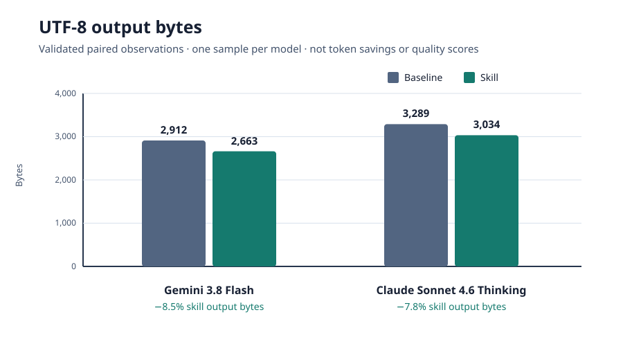
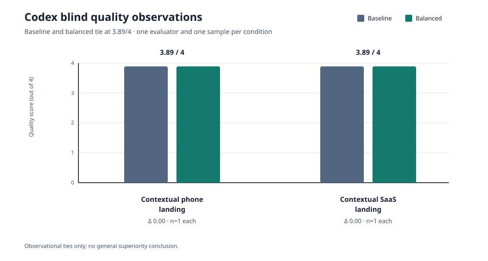

# Preliminary benchmark observations

These figures and tables summarize observed, paired comparisons from the same contextual product-language prompts. They are provided for transparency, not as a validated benchmark or a claim of general superiority.

## Visual summaries

## Output-byte observations

The following paired observations report UTF-8 output bytes. **Bytes are not tokens**, and the differences must not be described as token savings or latency improvements. There is one sample per model.

| Model | Baseline | Skill | Difference | Relative change |
|---|---:|---:|---:|---:|
| Gemini 3.8 Flash | 2,912 bytes | 2,663 bytes | 249 fewer bytes | −8.5% |
| Claude Sonnet 4.6 Thinking | 3,289 bytes | 3,034 bytes | 255 fewer bytes | −7.8% |

The skill output qualitatively improved avoidance of invented product features in the Gemini observation. In the Claude observation, it avoided some invented product examples and prices but still invented filters, photos, battery, reparation, and support details.

## Codex blind quality observations

These are observational quality scores from one evaluator and one sample per condition. They show ties, not evidence of general superiority.

| Context | Baseline | Balanced | Delta | Sample count |
|---|---:|---:|---:|---:|
| Contextual phone landing | 3.89/4 | 3.89/4 | 0.00 | n=1 each |
| Contextual SaaS landing | 3.89/4 | 3.89/4 | 0.00 | n=1 each |

Earlier phone/CTA pilot observations may be cited separately as historical one-sample observations: baseline and balanced both scored 3.57/4. They are not combined with the contextual observations and do not imply statistical proof.

## Interpretation limits

- The charts are observational summaries, not statistical analyses.
- One sample per model or condition cannot establish a stable effect, causal effect, or general product-quality claim.
- Codex quality ties are **not evidence of general superiority** for either condition.
- Byte differences are not token savings, latency measurements, or quality scores. No token or latency data is claimed here.
- The observed model-dependent claim drift remains material: Claude still produced unsupported details after avoiding some other inventions.

Further testing should use the paired protocol, repeated cases, blinded quality evaluation, and observed telemetry described in [`community-testing.md`](community-testing.md) and [`../benchmarks/README.md`](../benchmarks/README.md).
